# Breadboard Viewer

ブレッドボード上の配線をJSONで書いて、絵として共有するための静的Webアプリです。
Claude Code や Codex などのAIエージェントが、読み書きしやすい形式を目指しています。

**エディタ: https://monoradio102.github.io/breadboard-viewer/**

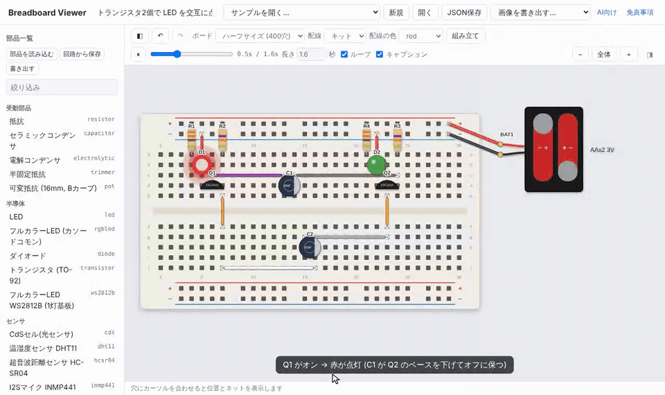

**AIに使わせるとき**は、Claude Code や Codex に次のURLを渡してください。リポジトリのクローンは不要です。
回路の書き方、1ファイルのコマンドラインツール (`dist/bb.mjs`)、ブラウザからの操作方法がまとまっています。

https://monoradio102.github.io/breadboard-viewer/llms.txt

よく使う場合は、**Claude のスキル**としてインストールしておくと、URLを渡さなくても
「ブレッドボードの配線図を描いて」と頼むだけで使われます (インストールのコマンドは llms.txt にあります)。
claude.ai では [skill/breadboard-viewer.zip](skill/breadboard-viewer.zip) をスキルとしてアップロードします。

## できること

- 静的ページのみで動きます (GitHub Pagesにそのまま置けます)
- 秋月電子などで手に入る、定番部品を36種類内蔵しています (抵抗、LED、フルカラーLED、DIP IC、7セグ、LCD1602、DHT11、HC-SR04、リレー、モーター、サーボ、スピーカー、電池ボックス、Arduino Nano、Raspberry Pi Pico、ESP32、XIAO ESP32、I2Sマイク INMP441、I2Sアンプ MAX98357A、WS2812B、OLED SSD1306、Qwiic など)
- 内蔵されていない部品は、回路ファイルの中にJSONで定義できます ([形式](docs/FORMAT.md))。定義した部品は「マイ部品」ライブラリとして保存・流し込みができます
- 回路ファイル1つ (JSON) で、独自部品も含めて共有できます。書き出したSVGにも回路データが入っているので、SVGをドロップすれば元の回路に戻せます
- 回路の検証と、ネットリスト (どのピン同士がつながっているか) の表示ができます
- 電源どうしのショート、抵抗なしのLED、GNDの未接続、電圧の過不足など、よくあるミスを **参考の警告** として表示します (回路の正しさを保証するものではありません)
- 動作のアニメーション (LEDの点滅、モーターの回転、サーボ、ボタン操作、信号の流れ、キャプション) を台本として書けます。書き出したSVGは、ファイル単体でもアニメーションします
- 煙や矢印などの演出は、任意のSVGアニメーションとして流し込めます (安全のため画像として描画し、スクリプトは実行しません)
- アニメーションは、フレームを指定して透過PNGの連番で書き出せるので、ffmpeg で GIF / MP4 にできます
- 組み立て手順モード: ボードの外に部品を並べたところから、手順ごとに配置していく様子を見せられます
- 配線の描き方を選べます: 曲がるジャンパ線 (弧を描いて浮く) か、市販のジャンパ線キット (板に沿って直角に折れ、長さで色が決まる。使う線の長さの一覧も出ます)

## サンプル

| | |
|---|---|
|  |  |
| [LED を交互に点滅 (無安定マルチバイブレータ)](examples/flasher-kit.json) ([エディタで開く](https://monoradio102.github.io/breadboard-viewer/?example=flasher-kit)) | [XIAO ESP32S3 + I2S マイク・アンプ](examples/xiao-voice.json) ([エディタで開く](https://monoradio102.github.io/breadboard-viewer/?example=xiao-voice)) |
|  |  |
| [モーター + サーボ](examples/motor-servo.json) ([エディタで開く](https://monoradio102.github.io/breadboard-viewer/?example=motor-servo)) | [HC-SR04 で距離アラーム](examples/distance-alarm.json) ([エディタで開く](https://monoradio102.github.io/breadboard-viewer/?example=distance-alarm)) |
|  |  |
| [Pico でボタン入力とLED](examples/pico-button.json) ([エディタで開く](https://monoradio102.github.io/breadboard-viewer/?example=pico-button)) | [独自部品 (OLED) の定義例](examples/oled-custom-part.json) ([エディタで開く](https://monoradio102.github.io/breadboard-viewer/?example=oled-custom-part)) |
|  |  |
| [スピーカー (ボード外に配置)](examples/tone-speaker.json) ([エディタで開く](https://monoradio102.github.io/breadboard-viewer/?example=tone-speaker)) | [演出レイヤー (煙のSVG) の例](examples/led-burnout.json) ([エディタで開く](https://monoradio102.github.io/breadboard-viewer/?example=led-burnout)) |

上の画像は、それぞれ1つのSVGファイルです。アニメーションはSVGの中のCSSで動いていて、回路データも埋め込まれています。
SVGを保存してエディタにドロップすると、そのまま回路を編集できます。
画像は `npm run images` で `examples/` から作り直せます。

### 配線の描き方

同じ回路を、2通りの描き方で描けます (`"wireStyle"`、エディタではツールバーの「配線」)。

| ジャンパ線キット (`"kit"`) | 曲がるジャンパ線 (`"flex"`, 既定値) |
|---|---|
|  |  |
| 板に沿って直角に折れ、部品の下を通ります。色は長さで決まり、`check` で使う線の長さの一覧が出ます | 部品の上に浮いて、経由点で自由に曲げられます。色は自由に選べます |

### 組み立て手順

部品をボードの外に並べたところから、手順ごとに配置していく様子を描けます (`steps`、エディタでは「組み立て」)。


## 使い方

```bash
npm run serve   # http://localhost:8000 で開く
```

- 左: 部品一覧。ボードにドラッグして置くか、部品をクリックして「回路に追加」を押します
  - 「部品を読み込む」: 部品ライブラリ (JSON) や回路ファイルの独自部品を「マイ部品」に取り込みます (ページへのドロップでも可)。「回路から保存」「書き出す」も使えます
- 中央: ブレッドボード (領域全体がキャンバスです。何もないところをドラッグで移動、ホイール / ピンチで拡大・縮小、「全体」で全体表示)
  - 部品をクリックで選択、ドラッグで移動します。LEDや抵抗などは、選択すると出る丸いハンドルで、足を1本ずつ動かせます
  - ボードの外にドラッグすると、部品を自由な位置に置けます (サーボ、スピーカー、電池ボックスなど)。ボードの上に戻すと穴に挿さります
  - 空いている穴や、ボード外の部品のピン (金色の丸) からドラッグすると、ジャンパ線を引けます (色はツールバーで選びます)
  - 線を選ぶと出る「＋」をドラッグすると、経由点が増えて線がなめらかに曲がります。経由点はドラッグで移動、ダブルクリックで削除できます
  - `R` で回転 (`Shift+R` で逆回転)、`Delete` で削除、矢印キーで1マス移動、`Ctrl+Z` / `Ctrl+Shift+Z` で元に戻す / やり直し
  - 穴にカーソルを合わせると、その穴と導通している穴が光り、穴の名前とネットが表示されます
- ツールバー: 元に戻す / やり直し、ボードの種類、配線の描き方 (曲がる / キット)、配線の色、アニメーションの再生・一時停止・シーク (`Space` でも再生 / 一時停止)・長さ・ループ・キャプションの表示 (書き出す画像にも反映)、拡大・縮小
- 「組み立て」: 組み立て手順モード。部品がボードの下に並び、手順ごとに配置されていきます (「◀ 前」「次 ▶」で1手順ずつ)。右のパネルで手順の説明と対象を編集でき、「自動で作る」で手順を自動生成できます
- 「画像を書き出す」: 透過PNG / 白背景PNG / 静止画SVG (いま表示している瞬間)、アニメーションSVG。組み立てモードのときは組み立て手順を書き出します
- 右: 選択中の部品のプロパティと、回路のJSON。JSONを編集すると、すぐに図に反映されます
- ツールバーの両端の「◧」「◨」で、左右のパネルを畳めます (画面が狭いとき用。状態はブラウザに記憶されます)
- JSON / SVG ファイルは、ページにドロップしても読み込めます

## コマンドライン (AIエージェント向け)

編集操作 (ops) の詳細は [docs/OPS.md](docs/OPS.md) を参照してください。

```bash
node tools/bb.mjs parts                                      # 使える部品とピン名の一覧
node tools/bb.mjs new my.json half                           # 空の回路を作る
node tools/bb.mjs apply my.json '[{"op":"addPart","type":"led","at":"a10"}]'  # 編集操作を適用する
node tools/bb.mjs check examples/blink-nano.json             # 検証とネットリストの表示
node tools/bb.mjs check examples/xiao-voice.json --layout --json  # 見た目の問題も含めて JSON で
node tools/bb.mjs place xiao --at h3 --rot 180               # 置いたときのピンの穴・覆う範囲・ぶつかり
node tools/bb.mjs coords h3 T-5 U1.D3                        # 穴やピンの座標
node tools/bb.mjs parts --json --type xiao                   # ピンの相対位置と本体の範囲
node tools/bb.mjs lib my-parts.json examples/oled-custom-part.json            # 独自部品を集めてライブラリにする
node tools/bb.mjs apply my.json '[{"op":"addPart","type":"oled-ssd1306-i2c","at":"d24"}]' --lib my-parts.json  # ライブラリの部品を使う
node tools/bb.mjs render examples/blink-nano.json -o out.svg # SVGに描画
node tools/bb.mjs render examples/blink-nano.json -o out.png # PNGに描画 (Playwrightが必要)
node tools/bb.mjs render examples/motor-servo.json -o f.png --time 1500 --transparent  # 1.5秒時点の透過PNG
node tools/bb.mjs frames examples/motor-servo.json -o frames --fps 30 --transparent --jobs 4  # 1周分の連番PNG (GIF / MP4 用)
node tools/bb.mjs render examples/xiao-voice.json -o mic.png --focus MIC1 --chrome     # 部品に寄った絵 (インストール済みの Chrome で)
node tools/bb.mjs render examples/blink-nano.json -o step2.png --step 2                 # 組み立て手順2の状態
node tools/bb.mjs frames examples/blink-nano.json -o asm --assembly                     # 組み立て手順の連番PNG
npm test
```

ブラウザでは、`window.bb` から回路を操作できます。

```js
bb.get()        // 現在の回路 (JSON)
bb.load(json)   // 回路を読み込む (→ { ok, errors, warnings, parts, wires })
bb.apply(ops)   // 編集操作を適用する (docs/OPS.md)
bb.check()      // 検証結果とネットリスト (テキスト)
bb.inspect(hole)// 穴にあるものとネット
bb.svg()        // 回路データ入りのSVG
bb.help()
```

## 構成

| パス | 内容 |
|---|---|
| `src/board.js` | ブレッドボードの形と、穴の名前 |
| `src/parts/builtin.js` | 組み込み部品 |
| `src/parts/registry.js` | JSONで定義した部品の読み込み |
| `src/circuit.js` | 回路の解決、検証、ネットリスト |
| `src/ops.js` | 編集操作 (UI・API・CLIで共通) |
| `src/render.js` | SVG描画 (ブラウザとNodeの両方で動きます) |
| `src/animation.js` | アニメーションの台本をCSSキーフレームに変換 |
| `src/app.js` | ブラウザのUI |
| `docs/FORMAT.md` | 回路ファイルの形式 |
| `docs/OPS.md` | 編集操作 |
| `examples/` | サンプル回路 |
| `docs/images/` | README用の画像 (`npm run images` で生成。`editor-demo.gif` は `npm run demo` で生成) |
| `tools/bb.mjs` | コマンドライン |
| `dist/bb.mjs` | コマンドラインを1ファイルにまとめたもの (`npm run build` で生成。Pagesから配布) |
| `docs/agent/common.md` | AIエージェント向けの手引きの本文 (`llms.txt` と `SKILL.md` の元) |
| `llms.txt` | AIエージェント向けの手引き (Pagesのトップから参照。`npm run build` で生成) |
| `skill/breadboard-viewer/` | Claude のスキル (`SKILL.md`, `bb.mjs`, `FORMAT.md`, `OPS.md`。`npm run build` で生成) と、その zip |

## 免責事項

部品データ (ピン配置、寸法など)、サンプル回路、ドキュメントは参考情報で、**誤りを含んでいる可能性があります。**
実際に配線する前に、必ずデータシートやメーカーの資料で確認してください。
検証機能は配線の構造だけを確認するもので、電気的に正しく安全な回路であることは保証しません。
本ツールの利用によって生じた損害について、作者は責任を負いません。詳しくは [DISCLAIMER.md](DISCLAIMER.md) を参照してください。

## ライセンス

[MIT License](LICENSE) です。クローンして改良したり、改良版を公開したりするのも自由です。
